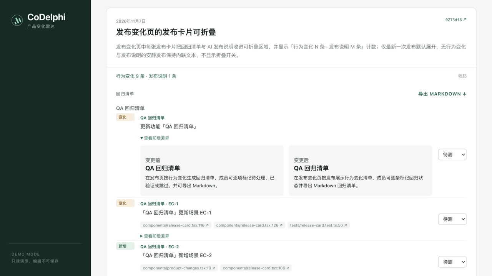
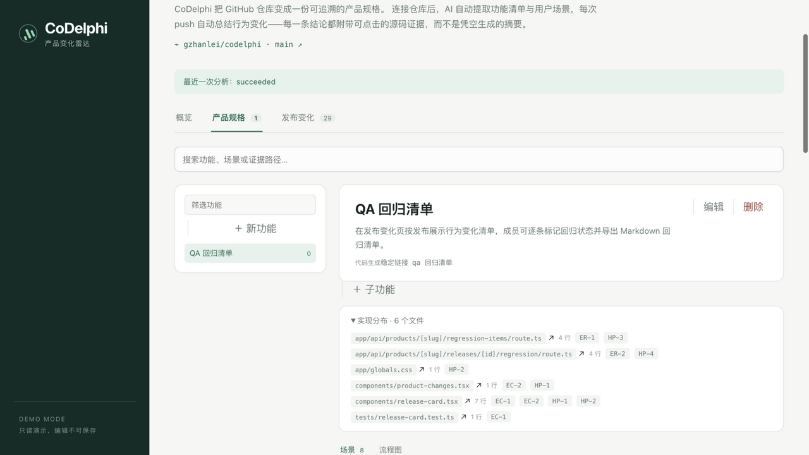
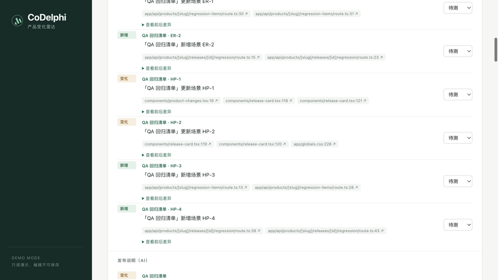
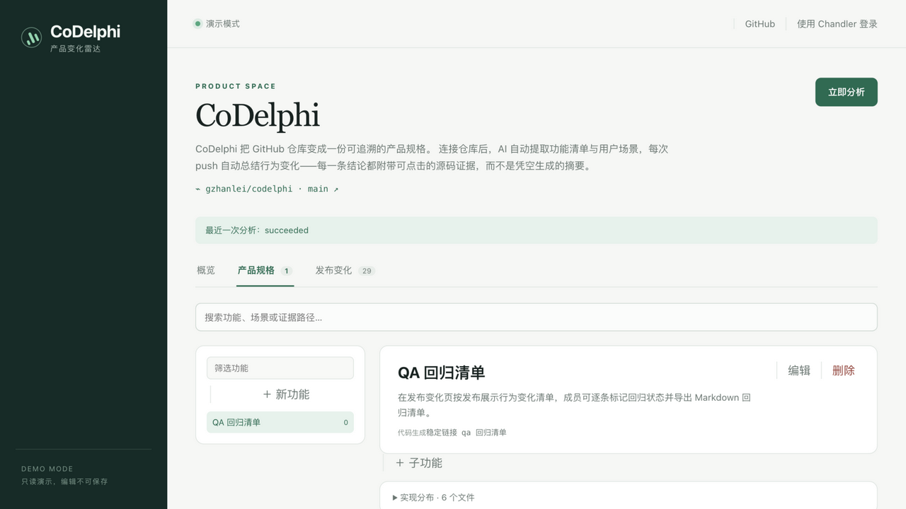
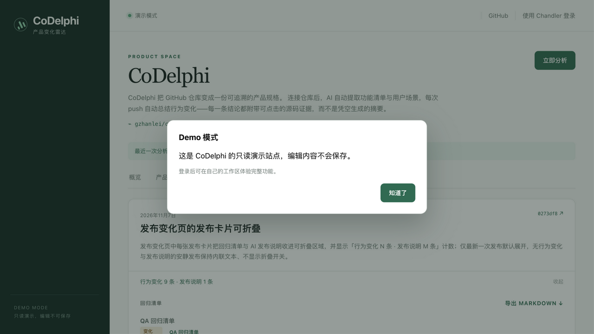
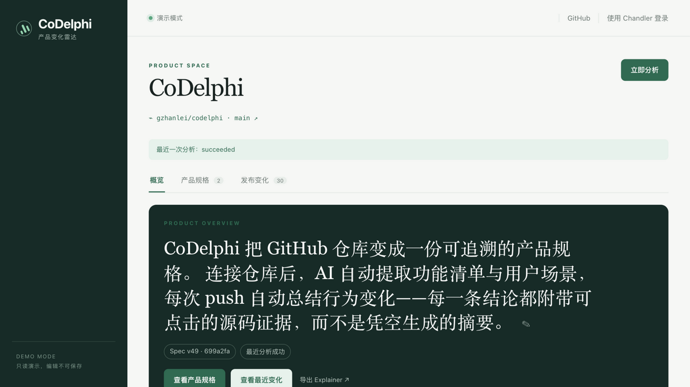
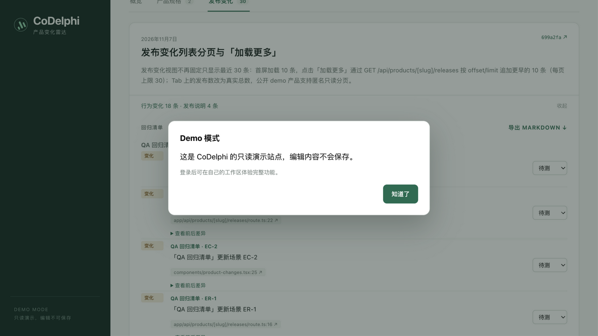

# Demo 页四角色场景走查报告

> 2026-11-07 基于公开演示页（https://codelphi.com/products/codelphi，演示模式、未登录）的黑盒 GUI 走查整理。走查方式：纯界面操作（点击、滚动、搜索、表单），全程截图留证，不读源码、不注入脚本。
>
> 本报告是 `docs/user-personas.md`（四类角色的**理想**使用方式）的实机对照篇：验证当前 demo 页面对四类角色的核心场景各自兑现到什么程度。
>
> 标注约定：**✅ 满足** ／ **⚠️ 部分满足** ／ **❌ 未满足**；问题按 P0（阻断/失真）/ P1（削弱说服力）/ P2（打磨项）分级。

---

## 核心结论（TL;DR）

1. **QA 是命中度最高的角色**：回归范围、用例与代码对齐、新版本测什么，三个场景全部有直接对应的功能界面。
2. **研发与产品经理基本满足**：「实现分布」（文件 ↔ 场景影响映射）和「变更前/变更后对比」分别回应了两个角色的核心痛点。
3. **CTO 是最弱一环**：进展汇报缺一键汇总出口，成员协作视角在 demo 中完全不可见。
4. **走查结论修正（2026-11-07 晚）**：初版报告曾判定「立即分析在 Demo 模式下真实执行并改写数据」为 P0 问题。经代码核实该判定**不成立**：客户端 `components/analyze-button.tsx:17` 的 `useDemoGuard()` 确实拦截了点击（弹窗即证据），服务端 `app/api/products/[slug]/analyze/route.ts:14` 的 `requireSessionUser()` 也会拒绝匿名请求。走查期间的数据变化（v47 → v49）来自远端新提交 699a2faa 触发的 **webhook 自动分析**——正是产品承诺的「每次 push 自动总结行为变化」在演示产品上的正常表现。

---

## 走查范围与方法

| 项 | 内容 |
|---|---|
| 对象 | `codelphi.com/products/codelphi`，DEMO MODE 横幅（只读演示，编辑不可保存） |
| 路径 | 概览 → 产品规格（列表/实现分布/流程图）→ 发布变化（展开/折叠/回归清单/前后差异/加载更多）→ 规格搜索 → Demo 拦截验证 |
| 账号 | 未登录匿名访客 |
| 记录 | 每个测试点均有 DOM 快照 + 截图双重留证，截图存于 `docs/assets/demo-review-2026-11-07/` |
| 未覆盖 | 登录后工作台、导出文件实际下载、多成员协作、移动端视口（走查桌面 1280×720） |

---

## 四角色逐项评估

### 产品经理

**痛点**（来自 `docs/user-personas.md`）：不知道研发到底做了什么；问研发要被打断；写需求时不知道现状边界。

| 场景 | 结论 | Demo 页实际兑现 |
|---|---|---|
| 不知道研发做了什么 | ✅ | 发布变化视图按发布给出「行为变化 N 条」清单，每条变化可展开**变更前/变更后**对比卡片（`10-before-after-diff.png`） |
| 问研发要被打断 | 🟡 | 场景以「情境 / 操作 / 结果」三段式描述，附 GitHub 行号级证据链接，具备自查基础；**但规格搜索对匿名访客静默失效**（`/api/.../spec/search` 307 → /login，UI 无任何提示，`components/spec-search.tsx:24` 的响应处理吞掉了失败），demo 上自助查询未闭环（登录后可用，交叉核对确认） |
| 写需求不知现状边界 | ✅ | 场景按 **正常路径 / 边界情况 / 错误路径** 三分类（HP/EC/ER 编号），现状边界显式化（`05-scenario-list.png`） |

**缺口**：写新需求时没有**反向影响查询**——输入设想的功能描述、查看与现有场景的重叠；目前只能靠规格搜索框做关键词匹配。

### 研发人员

**痛点**：接手陌生代码库；改动前不知道影响面；文档永远过时。

| 场景 | 结论 | Demo 页实际兑现 |
|---|---|---|
| 接手陌生代码库 | ✅ | 场景清单即「可执行文档」：每个场景标注路径类型与证据文件，配合流程图模式建立行为全貌（`06-flow-diagram.png`） |
| 改动前不知道影响面 | ✅ | 「实现分布」展示 **6 个文件 ↔ 8 个场景** 的双向映射，改某文件前可反查受影响场景（`04-implementation-map.png`） |
| 文档永远过时 | ✅ | Spec 版本号绑定 commit（走查时从 v47/0273df8 实时更新到 v49/699a2faa），证据链接全部指向当前 commit 的具体行号 |

**缺口**：影响面粒度止于**文件级**，无函数/模块级；跨功能的依赖关系无展示。

### QA

**痛点**：回归范围拍脑袋；测试用例和代码现实脱节；新版本来了不知道测什么。

| 场景 | 结论 | Demo 页实际兑现 |
|---|---|---|
| 回归范围拍脑袋 | ✅ | 每张发布卡片自带回归清单，逐条标记 **待测 / 已验证 / 跳过**，支持导出 Markdown（`09-regression-items.png`） |
| 用例与代码脱节 | ✅ | 每条场景带指向当前 commit 具体行号的证据链接，走查中抽验链接均可点击 |
| 新版本来了不知测什么 | ✅ | 最新发布**默认展开**、旧发布折叠为「行为变化 N 条 · 发布说明 M 条」摘要行；新增/变化徽标区分测试范围（`07-changes-top.png`、`08-collapsed-cards.png`） |

**缺口**：回归状态无「谁标记的」成员维度；「加载更多」分页存在且实测可用（30 条发布，每页 10 条）。

### CTO

**痛点**：团队互相打断；新人上手慢；对上说不清进展；知识都在个人脑子里。

| 场景 | 结论 | Demo 页实际兑现 |
|---|---|---|
| 团队互相打断 | ⚠️ | 规格作为共享事实源可间接减少口口相传，但无通知/订阅等主动分发（与 personas 中【缺口：通知分发】一致） |
| 新人上手慢 | ✅ | 概览 → 规格 → 流程图 → 证据的阅读路径完整，规格工作台含搜索、筛选、稳定链接（`03-spec-workbench.png`） |
| 对上说不清进展 | ⚠️ | 发布时间线（30 条，每条带标题+摘要+commit 链接）可当素材，但**无一键汇总/周报导出** |
| 知识在个人脑子里 | ⚠️ | 有人工编辑机制（「人工功能 / 场景 0 / 0」计数位、编辑产品概况按钮），但 demo 未登录，成员协作视角完全不可见 |

---

## 发现的问题

### 走查结论修正：原 P0「立即分析改写数据」不成立（降级为 P2 观察项）

- **初版判定**（已撤回）：「Demo 模式下点击立即分析，真实执行分析并改写共享演示数据」。
- **复核事实链**：
  1. 客户端：`components/analyze-button.tsx:17` 调用 `useDemoGuard()`，demo 模式下点击仅弹窗、不发请求——走查截图中的弹窗正是 guard 生效的证据；
  2. 服务端：`app/api/products/[slug]/analyze/route.ts:14-17` 先 `requireSessionUser()` 再 `requireProductAccess(user, slug, "editor")`，匿名 POST 无法触发分析；回归状态接口 `app/api/products/[slug]/regression-items/route.ts:14` 同样有会话与权限校验；
  3. 数据变化的真实来源：走查期间远端 main 出现新提交 **699a2faa**（feat: paginate the changes view with a load-more control），webhook 自动触发分析，演示产品随之更新为 Spec v49——功能 1→2、发布 29→30 均为该次分析的产出，与按钮点击无关。
- **仍然成立的观察项（P2）**：演示产品跟随真实仓库演进，意味着①访客看到的内容随时间漂移，外部分享的截图/说明可能与实际页面不一致；②演示数据形态取决于 codelphi 仓库自身的功能分布，当前仅 2 个功能，天然偏薄。是否将 demo 数据「快照化固化」是一个产品决策点，见 `docs/demo-improvement-plan.md`。

### P1 · Demo 内容形态随 push 剧烈波动，撑不起四角色叙事 【已修复 2026-11-07】

走查时点初始状态仅 **1 个功能、8 个场景**（webhook 更新后 2 个功能）。**补充观察（同日晚）**：功能数随后又变为 **14**（发布变化 30 → 35）——一天内 1 → 2 → 14 的剧烈波动实证了规格形态由「最近几次 push 碰过什么」决定，而非产品真实面貌（根因分析见 `docs/demo-improvement-plan.md` I1）。

**✅ 修复验证（同日晚）**：根因（`upsertGeneratedSpec` 以 AI 原始输出为下线基准，工作台层缺失 carry-forward）已由 M9 工作区当日修复并完成对账。生产只读复验：最新版本 v58 版本层 14 = 工作台 14，双向差集为空；线上角标恢复「产品规格 14」。产品裁决：**demo 数据维持 live 演进**（见改进计划 A2）。遗留跟进：两层集合等价的常驻回归测试固化。

### P2 · 打磨项

1. CTO 视角建议增加「按周聚合的变更摘要导出」，直接回应「对上说不清进展」。
2. 回归状态补充标记人/时间（登录后），支撑团队协作叙事。
3. 流程图模式节点文字有截断省略（`06-flow-diagram.png` 中「…作为 inde…」），可加悬浮提示。

---

## 值得保持的亮点

1. **「每条结论附可点击源码证据」贯穿全站并实际兑现**——规格场景、回归清单、变更条目三处证据链接全部指向具体 commit 的具体行号，这是与竞品文档（`docs/user-personas.md` 赛道 B/C）最锐利的差异点。
2. **信息层级设计合理**：最新发布默认展开、旧发布折叠；概览按「核心能力 → 最近变化 → 规格可信度」组织，首屏即可回答「这是什么/最近怎么了/可信吗」。
3. **Demo 拦截统一且有引导**：编辑操作一律弹出同一弹窗并给出「登录后可在自己的工作区体验完整功能」的出口。
4. **自查机制设计正确**：规格搜索（M3，登录后可用）、文件级影响反查（实现分布）、稳定链接的组合方向正确。⚠️ 但匿名 demo 下搜索接口 307 → /login 且 UI 静默无提示（交叉核对确认，见下文），导出类入口同样跳登录——「不打断研发的自查」在未登录访客身上尚未兑现。

---

## 附录

### 走查操作记录（摘要）

1. 打开 demo 页 → 确认 DEMO MODE 横幅与「最近一次分析 succeeded」。
2. 概览页三个区块逐屏浏览截图。
3. 进入产品规格视图：功能树、场景列表（8 条）、实现分布展开、流程图模式切换。
4. 进入发布变化视图：最新卡片默认展开（回归清单 + 导出 MARKDOWN + AI 发布说明），旧卡片折叠态确认，「加载更多」按钮存在。
5. 展开一条「查看前后差异」，确认变更前/变更后对比。
6. 修改回归状态下拉 → Demo 拦截弹窗（编辑被阻断，符合承诺）。
7. 规格搜索 `release-card` → 功能树出现第二个功能（**事后核对：该归因有误**——匿名搜索接口 307 静默失效，第二个功能来自并发的 webhook 分析，与搜索无关）。
8. 点击「立即分析」→ Demo 弹窗（点击被 guard 拦截，未发请求）。同一时间段远端新提交 699a2faa 经 webhook 触发自动分析，演示数据更新（初版报告误归因于该点击，已修正，见上文）。
9. 复核发布变化视图分页与状态下拉控件（加载更多 ×1、状态下拉 ×18）。

### 交叉走查核对（Kimi 评审，2026-11-07 晚）

另一 AI（Kimi）对同一 demo 做了独立走查。逐条核对其事实主张的结果：

| Kimi 主张 | 核对结论 |
|---|---|
| 注释提交产生 17/11 条行为变化，与发布说明矛盾 | **当时属实，当晚已修复**：M9 工作区中午上线 0.70 漂移门槛（发布 #59/#60/#65 标题记录了部署）；现测注释提交仅 1 条诚实 `reviewed` 条目（「route.ts 末尾新增一行注释，读取/保存逻辑未改动」）。Kimi 走查撞上的是修复前的旧数据 |
| 匿名搜索无结果 | **属实且更严重**：不是匹配不到，是接口 307 → /login 且 UI 静默吞错（无意义词也返回全部功能 = 无过滤）；登录后可用 |
| 回归导出 / Explainer 匿名跳登录 | **属实**（curl 实测 307 → /login）；注意 releases 列表 API 匿名可用——暴露面不一致 |
| Live 数据漂移（40→42 发布等） | 属实，但为 A2 已裁决的 live 策略预期行为；噪声修复后「边看边变且自相矛盾」的主因已消除 |
| 编辑/删除/分析入口对匿名可点击 | 属实但属有意设计（统一 Demo 拦截弹窗）；「编辑面板能打开」的收敛建议记为 P2 |
| 证据强度应分级（实现/测试/文档/提示词） | 采纳为 P2：链接到 README/prompt 的证据只证明「文档这样要求」，不证明「运行时如此执行」 |
| 冻结且人工验收的演示基线 | **不采纳**：与 A2 裁决（保持 live）冲突；采纳其子项——页面已有 Spec vNN·sha 徽章，可补更新时间展示 |
| 研发「事前影响分析」缺失（❌） | 部分不同意：实现分布 + 筛选已提供文件→场景的静态反查（🟡）；缺的是「粘贴 diff/PR → 预测影响」的事前流，并入 C2 探索项 |

由此确认的待办：**B3（新，P1）demo 匿名可用性收敛**；C2 扩展事前影响分析；两个 P2（证据分级、无效入口收敛）。见 `docs/demo-improvement-plan.md`。

> 说明：全程未做任何注入或绕过界面的操作；写操作均被前端 guard 与服务端鉴权双层拦截（代码证据见上文复核）。走查工具不支持采集浏览器控制台日志，全程未见白屏、报错文案或布局破损等可见异常（全页截图中头部重复为截图工具对 sticky 头部的伪影，实机浏览正常）。

### 截图索引（`docs/assets/demo-review-2026-11-07/`）

| 文件 | 内容 |
|---|---|
| `01-overview-top.png` | 概览页首屏 |
| `02-overview-credibility.png` | 概览页「规格可信度」区块 |
| `03-spec-workbench.png` | 产品规格工作台 |
| `04-implementation-map.png` | 实现分布（文件 ↔ 场景映射） |
| `05-scenario-list.png` | 场景列表（HP/EC/ER 分类） |
| `06-flow-diagram.png` | 流程图模式 |
| `07-changes-top.png` | 发布变化视图首屏（最新发布默认展开） |
| `08-collapsed-cards.png` | 旧发布折叠态 |
| `09-regression-items.png` | 回归清单条目与状态标记 |
| `10-before-after-diff.png` | 变更前/变更后对比 |
| `11-demo-modal.png` | 点击「立即分析」的 Demo 弹窗 |
| `12-spec-v49-after-analyze.png` | 分析后 Spec v49 |
| `13-demo-modal-edit-blocked.png` | 修改回归状态被拦截 |
