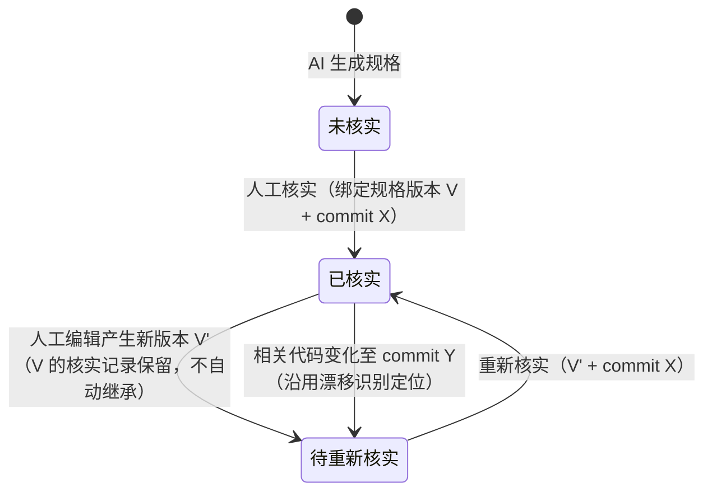

# CoDelphi 产品能力成熟度基线与演进路线

> 本文档是一份**基线文档**：严格区分「已实现 / 部分实现 / 未实现」，供后续任何评审者（人类或 AI）先理解真实产品状态，而不是从官网文案或推断出发。
>
> **基线元数据**：最后核实日期 2026-11-08（P0 部署后对账）；对账代码范围 `e99f594…502fbe2`（main）；migrations 至 `027_regression_tasks.sql`（2026-11-08 生产已应用：2520 条历史任务回填、旧 regression_items 下线）。P0 影响面→回归联动已部署生产（codelphi.service 重启于 migration 之后），线上端到端验收见 P0 节。核心能力的部分条目（滑窗坍缩 P0 修复、webhook 健康）经过 2026-11-07 生产只读验证（见 [demo-improvement-plan.md](demo-improvement-plan.md)）；其余能力以代码与测试为证。
>
> **修订记录**：2026-11-07 初稿；2026-11-08 按外部评审修订后冻结 v1（P0/P1 数据模型收敛、P2 归因审计、证据分级、基线元数据）。
>
> 与 [product-roadmap.md](product-roadmap.md) 的关系：该文档是 2026-11-06 的规划文档（里程碑 M1–M13），本文档是 2026-11-08 的实测对账——其中相当一部分「规划中」的能力实际已经落地，以本文档为准。
>
> **使用约定**：每次重大版本发布，用本文档做一次能力对账并更新基线元数据，避免基线悄悄过时。**冻结的含义**：v1 冻结的是基线事实与 P0/P1/P2 路线决策——不代表三项的技术设计已完成（P0 进入独立技术设计，P1 先完成状态转换表与历史核实模型，P2 等 P0 数据模型稳定后实施），也不代表所有已实现能力都经生产验证（范围见上方基线元数据）。基线文档只在能力实际变化或对账时更新，设计细节不在这里反复扩展。

## 评估原则

1. **能力状态以代码、数据库结构和实际运行行为为准。** 官网文案、产品设计文档、AI 推断均不能单独作为「已实现」的证据。
2. 每条已实现声明附代码路径与关键 schema；有对应测试的注明测试文件。
3. **证据分级**：实现证据（代码/数据库结构存在）< 行为证据（关键路径有测试或端到端验证）< 产品证据（用户能通过实际界面完成任务）。核心用户价值能力至少要有实现证据 + 行为证据；有 API route ≠ 能力完整，有 migration ≠ 线上已执行，有 UI ≠ 用户能走通。
4. 「部分实现」必须同时写明已实现部分与剩余缺口，不允许含糊。
5. 「未实现」不把愿景写成能力；未实现项允许引用规划文档，但不得表述为现有功能。
6. 本文档跟随代码演进：能力落地或推翻时更新对应条目，而不是另起新文档。

## 产品边界（产品哲学）

CoDelphi 不负责宣称自己理解了整个软件系统，而是负责让团队能够持续建立、检查、修正和验证对软件系统的理解。由此推导五条边界，全文档的能力表述不得越过：

1. AI 提取的规格不是天然正确的。
2. 人工修改不意味着已经核实。
3. 代码变化不意味着一定发生产品行为变化。
4. 影响面推荐不意味着完整测试覆盖。
5. 有人验证过，不意味着整个团队掌握了知识。

## 四类角色与核心任务

角色画像详见 [user-personas.md](user-personas.md)。2026-11-07 四角色实测走查结论：**QA 场景匹配最强，CTO 最弱**（详见 [demo-four-roles-walkthrough.md](demo-four-roles-walkthrough.md) 与 [demo-improvement-plan.md](demo-improvement-plan.md)）。场景匹配度与能力成熟度分开表述：

| 角色 | 当前场景匹配 | 主要限制 |
|---|---|---|
| 产品经理 | 高 | 产品意图与代码事实仍需区分（P1 核实状态） |
| 研发人员 | 高 | 影响分析基于证据路径，不是完整依赖分析 |
| QA | 高 | 影响面与回归工作流尚未打通（P0） |
| CTO | 中 | 缺乏主动知识发现与组织级洞察（P2）；进展摘要只解决技术进展可见性，不等于管理需求已满足 |

## 当前能力成熟度总表

| 能力 | 状态 | 证据（代码路径 / schema） |
|---|---|---|
| 代码 → 产品规格分析管线（push 触发 + 手动触发） | ✅ 已实现 | `lib/analysis.ts`、`lib/manual-analysis.ts`、`app/api/webhooks/github/route.ts`、`app/api/products/[slug]/analyze/route.ts` |
| 增量分析引擎（M9，滑窗坍缩 P0 已修复） | ✅ 已实现 | `lib/incremental.ts`、`lib/incremental-shadow.ts`、migrations `019_analyze_mode`/`020_analysis_run_dedup`/`026_incremental_default`；行为证据：`tests/incremental.test.ts`、`tests/incremental-shadow.test.ts`；修复见 demo-improvement-plan.md I1（含生产只读验证） |
| 孤儿分析 run 自动补跑 | ✅ 已实现 | `lib/analysis-recovery.ts`（commit e99f594）、`tests/analysis-recovery.test.ts` |
| 规格版本链 + 行为 diff | ✅ 已实现 | `lib/spec-versions.ts`、`lib/spec-diff.ts`、`lib/spec-change-view.ts`、migration `002_spec_versions.sql` |
| 人工修订规格 + manual 保护（自动分析不覆盖） | ✅ 已实现 | `lib/spec-editor-service.ts`（`source='manual'` 语义）、`lib/spec-editor-ui.ts`；行为证据：`tests/spec-editor-persistence.test.ts`、`tests/spec-editor-errors.test.ts`；红线写入 AGENTS.md |
| 规格漂移追踪（M8） | ✅ 已实现 | `lib/spec-drift.ts`、migration `018_spec_drift.sql`（`stale_since`/`stale_change_id`）；行为证据：`tests/spec-drift.test.ts` |
| 影响面查询（文件路径 → 受影响功能/场景，事前影响，规格页入口；UI 已更名「行为查询」——它交付的是文件实现了哪些产品行为，精确影响由 PR 预演与发布回归任务在知道改动内容后给出） | ✅ 已实现 | `lib/spec-file-index.ts`、`app/api/products/[slug]/impact/route.ts`、`components/impact-query.tsx`（C2，commit 70ba11b + ec37f45；结果可读化 + stable-key 链接修复 af67e94）；行为证据：`tests/impact-query.test.ts`、`tests/impact-preview.test.ts`、`tests/spec-file-index.test.ts` |
| PR 预演（受影响规格评论到 PR） | ✅ 已实现 | `lib/pr-preview.ts`（`AffectedSpecEntry`、issue comment upsert）；行为证据：`tests/pr-preview.test.ts` |
| QA 回归清单（逐条勾选 + 标记人 + Markdown 导出） | ✅ 已实现 | 已并入场景级回归任务（见上）；原 `022_regression_items.sql` 变更级清单由 migration 027 迁移并下线（f7b0289 的标记人展示保留于任务模型） |
| 行为变化通知分发（Slack / 通用 webhook / email 偏好） | ✅ 已实现 | `lib/notifications.ts`、`lib/notification-client.ts`、migrations `021_notification_channels`/`023_user_email_prefs` |
| 稳定引用 + 规格搜索 + 导出（M3） | ✅ 已实现 | `lib/stable-links.ts`、`lib/spec-search.ts`、`lib/scenario-export.ts`、`app/api/products/[slug]/spec.json/route.ts` |
| 进展摘要导出（CTO「对上说不清进展」） | ✅ 已实现 | `lib/progress-summary.ts`、`app/api/products/[slug]/progress-summary/route.ts`（B1，c968065）；行为证据：`tests/progress-summary.test.ts`、`tests/progress-summary-route.test.ts` |
| 测试骨架导出（M7） | ✅ 已实现 | `app/api/products/[slug]/export/tests/route.ts`、`tests/export-tests-route.test.ts` |
| 证据体系（含证据强度分级 [测试]/[文档]） | ✅ 已实现 | `lib/evidence.ts`、`lib/evidence-url.ts`、`tests/evidence-kind.test.ts`（a4e8d4d）、migration `014_product_description_evidence.sql` |
| 多租户 / 组织 / 邀请 / 成员 | ✅ 已实现 | migrations `008_multi_tenant`–`010`、`016_product_members`；`lib/organizations.ts`、`lib/organization-invitations.ts` |
| Chandler OAuth 登录 | ✅ 已实现 | `lib/chandler.ts`、`lib/oauth.ts`、`lib/session.ts` |
| GitHub App / webhook / 仓库连接 | ✅ 已实现 | `lib/github-app.ts`、`lib/github-webhook.ts`、`lib/github-connections.ts`、migrations `003`/`012`/`013` |
| 公开只读 demo 页（匿名可用性收敛） | ✅ 已实现 | `lib/public-demo.ts`、migration `025_product_public_demo.sql`、`tests/demo-guard.test.ts`（B3，f12699c） |
| 影响面 → 回归范围联动（P0） | ✅ 已实现并经生产端到端验收（2026-11-08） | 场景级回归任务：`lib/regression-tasks.ts` + `lib/regression-task-view.ts`、migration `027_regression_tasks.sql`（任务 (release, scenario) 唯一、来源多对多、三类推荐理由、四态验证）、分析事务内生成（`lib/analysis.ts` `ensureRegressionTasks` + `release_files`）、规格页与 Markdown 导出（`components/release-card.tsx`）；行为证据：`tests/regression-tasks.test.ts` 等。生产验收（release 71 / run 100）：4 个改动文件落库、20 条任务分析时生成、5 条 evidence_path 命中精确对应被触碰文件与场景、导出含合并理由 |
| 规格确认状态（人工核实 ≠ 人工编辑，P1） | ✅ 已实现（2026-11-08） | migration `028_spec_verification.sql`（`verified_at`/`verified_by` + append-only `spec_verifications` 双版本历史）；状态由 `verified_at × stale_since` 推导（不存状态列）；核实动作 `POST /spec/verify`（editor）+ `lib/spec-verification.ts`；编辑清 stale 语义已移除，核实是唯一清 stale 的人工动作；UI：场景卡/功能头三态徽章 + 核实按钮 + 场景工具栏核实筛选；行为证据：`tests/spec-verification.test.ts` 等 8 项。**线上端到端验证待部署后执行** |
| 知识健康视图（stale 分布 / 验证覆盖 / 维护分布） | ⚠️ 部分实现 | 可冷启动数据：`stale_since`（`product-details.ts:42,91` 已透出）、`regression_items.checked_by`（验证人，`checked_at`）。**缺口（2026-11-08 代码核实）：规格编辑归因未持久化**——`spec-editor-service.ts` 的全部 INSERT/UPDATE 均不记录编辑人，migrations 无归因列；「维护分布」维度缺数据基础（见 P2） |
| 多代码托管（M12） | ⚠️ 部分实现 | adapter 抽象已建：`lib/code-hosting/`（`adapter.ts`/`registry.ts`）；仅 `github-provider.ts`，Gitee/GitLab 未实现 |
| MCP server（M10） | ✅ 已实现 | A1（2026-11-10 上线）：8 只读工具、协议符合性 13/13、越权隔离、返回项带 stable link + 证据 URL（`lib/mcp/server.ts`、`lib/mcp/oauth.ts`、`migrations/055`/`056`）；key 签发 UI + 撤销路由（aa5fff5，`app/api/mcp-keys/*`）此前仅脚本路径 |
| 发布稿（release notes）发布动线（M11 扩展） | ✅ 已实现（GTM 桥面批次 1，53c267e） | 真块级改写（migration 060 `summary_override`）、已发布只读 409、release 归属校验、share_token 重生成不换、公开页 `/share/notes/[token]` 限流 + override 渲染、Markdown 导出、发布卡面板（勾选不自动全选 → 生成 → 校对 → 发布 → 公开链接）；**待部署，产品证据待线上验证** |
| 周期 Digest（内部周报） | ✅ 已实现（GTM 桥面，b08a02a） | 滚动 7 天窗口、无变化周不生成、digests 落库幂等、渠道+邮件投递（`lib/digest-sweep.ts`、sweep 注册 `digest-weekly`）；确定性组装零生成文本；**待部署** |
| 介绍材料 + PPT（GTM 表达层） | ✅ 已实现（GTM 桥面批次 2，d321315） | 定位块（manual 主张只逐字引用）+ 账本事实清单 → AI 结构化大纲（锚定校验，悬空锚点整稿拒绝）→ PPTCreator（easymakeppt.com）/mcp partner 烧片（`lib/ppt-partner.ts`）；计费口径=免费+如实记账（`llm_call_receipts.call_kind='intro_material'`，migrations 061–063）；**待部署；PPT 链路生产实测待做** |
| 外部仓库跟踪（M13，盯别人仓库） | ❌ 未实现 | — |
| Bus Factor / 知识掌握确认机制 | ❌ 未实现 | — |
| 跨模块调用图 / 运行时依赖分析 | ❌ 未实现 | 影响面基于规格证据路径匹配（`spec-file-index.ts`），非调用图 |
| 自动生成 / 执行测试用例、测试充分性判定 | ❌ 未实现 | 测试骨架导出 ≠ 自动生成用例 |
| 需求 / 设计决策等代码外信息接入 | ❌ 未实现 | — |

## P0 · 影响面 → 场景 → 回归联动（QA 工作流闭环）

**状态：已实现，生产端到端验收通过（2026-11-08）。** 实现与设计约束的对应：任务 = 场景验证任务（`(release_id, spec_scenario_id)` 唯一，migration 027 CHECK 约束保证主体二选一）；变化来源多对多汇总（`regression_task_sources`）；推荐理由为可追溯关联记录（`regression_task_reasons`，三类：behavior_change / evidence_path / feature_wide）；四态验证 + 跳过原因 + 未通过备注（`regression_tasks.status/skip_reason/failure_note`）；导出含理由与来源计数。

**端到端验收记录**：部署 migration 027（生产回填 2520 条历史任务、旧表下线）后，真实推送 `7fa4230`（影响面推荐任务携带场景上下文）触发 webhook 分析（run 100 succeeded）：`release_files` 落库 4 个改动文件 → 20 条场景任务在分析事务内生成 → 5 条 evidence_path 命中精确对应被触碰文件（`lib/regression-task-view.ts`、`tests/regression-tasks.test.ts`）与 QA 回归清单功能的 HP-3/EC-1/EC-2 等场景 → 导出正确渲染「行为变化；证据路径命中 …」合并理由。验收中一项附带发现：docs-only 推送（run 99）被 AI 证据守卫正确拒绝（AI 引用了不在源码切片与 diff 内的证据路径）——守卫行为符合「可追溯证据」红线，属 AI 瞬时错误类，重试通过。

**最高优先级。** 强化 QA 最强场景，把两条独立链路合成一条：

### 设计约束（本对话已收敛的决策）

1. **回归项 = 一次具体的场景验证任务，以场景为唯一粒度。** 模型：Release → Regression Item（场景验证任务）→ 关联 Scenario；spec_change 作为「变化来源」多对多关联，另关联推荐依据。唯一性约束取 `(release_id, scenario_id)`——同一场景可能同时受多个 spec_change 影响，但 QA 不应重复验证同一场景，多个变化来源**汇总**到同一个回归任务。（现有 `022_regression_items.sql` 以 `(release_id, spec_change_id)` 为粒度，场景信息在持久化层丢失。）
2. **推荐理由是可追溯的关联记录，不是单个枚举字段。** 一条推荐可同时具有多种理由（如：直接命中证据路径 + 所属功能被判定整体受影响），只存一个 reason 会丢信息。理由记录至少保留：命中的文件路径、对应规格/场景、命中类型（沿用影响面查询的既有标注语义）、来源 spec_change、生成时对应的分析版本。第一版不必全部展示，但数据结构不得堵死扩展。
3. **验证结果与推荐状态分离。** 推荐一条回归项 ≠ 已经验证过。状态至少区分：待验证 / 已通过 / 未通过 / 跳过（现有 `ENUM('pending','verified','skipped')` 需扩展）。「未通过」应能记录发现的问题或关联缺陷——这是未来形成「某类代码变化反复导致某些场景回归失败」知识积累的数据基础。「跳过」允许（但不强制）记录原因（如无关 / 环境受限 / 时间不足），否则后续统计只知道多少项被跳过，不知道为什么。
4. **文件路径匹配 ≠ 功能影响**：推荐是「推荐」，必须保留证据链与理由展示，不得表述为完整测试覆盖（产品边界第 4 条）。

### 验收标准

- 真实代码变更端到端验证：改动文件 → 正确识别受影响场景 → 推荐合理回归项（附理由与证据链接）→ QA 勾选回流。
- 同一场景受多个 spec_change 影响时，回归清单中只出现一条任务，且能展开全部变化来源与理由。
- 回归清单导出包含场景级条目与推荐理由。
- 「未通过」状态可记录问题描述；状态四选一跨会话持久。
- 误报可解释：每条推荐可追溯到证据路径或影响判定依据。

## P1 · 规格确认状态（知识可信度）

把「来源 / 时效 / 确认」三个独立维度落到 schema：

| 维度 | 回答的问题 | 现状 |
|---|---|---|
| 来源 | AI 生成还是人工修订？ | ✅ `source` 已有 |
| 时效 | 是否与当前代码漂移？ | ✅ `stale_since` / `stale_change_id` 已有 |
| 确认 | 是否经人工核实？与哪版规格、哪版代码核实一致？ | ❌ 待加 |

### 核实对象的定义

核实 = 「**规格条目当前版本的内容**与**指定代码版本的实际行为**一致性」的人工确认。不是核实「条目 ID 存在」，也不是核实「某个场景在运行时的行为」——后者需要运行环境，不在本项范围。

因此核实记录必须绑定双版本，只记 `verified_at`/`verified_by` 无法回答「核实的是哪版规格、哪版代码」：

- `verified_spec_version_id`（关键：否则人工核实后又改文字，旧核实会被错误沿用到新内容）
- `verified_commit_sha`
- `verified_at`
- `verified_by`

### 生命周期与失效规则

三条失效/保留规则：

1. **编辑不清除、不覆盖、不删除核实记录**：人工编辑产生新规格版本后，历史核实记录保留，但当前版本失去已核实资格，回到待核实。现有「编辑即清除 stale 并隐含视为核实过」的语义（`spec-editor-service.ts:110,164` 重置 `stale_since = NULL`）必须拆开：**stale（时效）只能由核实动作或重新分析合并清除，编辑动作不动它**。
2. **stale 与 verification 是两个独立状态，不能互相推导**：
   - `stale`：**系统判断**规格是否因相关代码变化而过时。重新分析合并可以清除旧漂移标记——因为它完成了新一轮代码事实分析；这意味着 AI 生成的新规格在系统判断层视为「与当前代码一致」，但**这不等于人工核实**。
   - `verification`：**人工确认**指定规格版本与指定代码版本一致，只能由人工核实动作建立。
   - 清除 stale 不赋予已核实状态；核实通过也不阻止后续代码变化再次打上 stale。
3. **只有相关代码变化才使核实失效**：沿用既有规格漂移识别机制（`lib/spec-drift.ts`，按变化影响的证据路径定位），代码发生任何变化 ≠ 所有规格整体重新核实——否则大型仓库中核实状态频繁整体失效，用户会失去信任。
4. **历史核实记录构成审计链**：谁、何时、对哪版规格、对哪版 commit 核实过，保留全部历史。

> 关联现状：证据强度分级（[测试]/[文档] 标记，a4e8d4d）已部分覆盖「这条结论的证据多硬」，但不覆盖「这条规格是否被人工核实过」——两者互补，不互相替代。**不引入 AI 置信度分数**：AI 自评把握、代码证据命中、人工核实一致是三件不同的事，当前优先建立清晰的人工核实语义，而不是制造看似精确的可信度数字。

### 验收标准

- 核实动作记录核实人、时间、规格版本 ID 与 commit SHA。
- 人工编辑产生新规格版本后，原核实记录保留，且不自动继承到新版本（验收重点，评审指出的缺口）。
- 编辑动作不改变 `stale_since`；仅核实动作或重新分析合并可清除漂移标记。
- 相关代码变化后，受影响的已核实条目自动回到待核实；无关条目不受影响。
- 规格页可按核实状态筛选。

> **状态：已实现（2026-11-08）。** 设计 [spec-verification-lifecycle-design.md](spec-verification-lifecycle-design.md) 的状态转换表 6 条转换全部落地（转换 3 的「编辑清 stale」语义已移除；转换 1/2 用 SQL 内容比对实现），核实状态筛选在场景工具栏。剩余：部署后线上端到端验证（核实 → 徽章变化 → 代码变化后转待重新核实）。

## P2 · 组织知识健康（从查询走向主动发现）

第一版**只展示事实性统计，不做综合健康分数**（产品边界：展示有依据的事实，不创造看起来权威的指标）。

### 数据可用性审计（2026-11-08 代码核实结论）

| 指标 | 数据基础 | 判断 |
|---|---|---|
| 规格新鲜度 | `stale_since`（`product-details.ts:42,91` 已透出） | ✅ 可做，只缺聚合视图 |
| 场景验证情况 | `regression_items.checked_by` + `checked_at` | ⚠️ 可做，但依赖 P0 的场景级关联先行（现粒度为 spec_change） |
| 知识维护分布 | ❌ **规格编辑归因未持久化**：`spec-editor-service.ts` 全部写入不含编辑人，migrations 无归因列；`checked_by` 只证明「谁执行了回归验证」，不证明谁维护规格、谁理解场景、谁负责模块 | ❌ 缺数据基础，列为后续数据模型工作（编辑归因字段 + 编辑历史），**不得通过推断补齐** |

### 第一版展示内容（全部为事实统计）

- 当前 stale 规格数量；长期 stale 规格列表。
- 本次发布推荐场景数；已通过 / 未通过 / 待验证 / 跳过的数量（依赖 P0 四态）。
- 最近一次验证时间。

**不做**：验证覆盖率百分比之类的综合口径——「已验证场景数 / 全部场景数」的分母不成立（并非所有场景都需每次发布回归；被推荐但跳过 ≠ 没有测试；历史版本验证记录 ≠ 当前版本仍有效）。综合知识健康分数明确不做。

### 边界

- **第一版不做 Bus Factor**。「维护记录 ≠ 掌握知识」（产品边界第 5 条）；Bus Factor 需要明确的知识掌握确认机制，后续单独探索。
- **从已验证的规格和回归记录出发归因，不从 commit 次数推断知识**。前者是已有事实，后者是猜测。
- CTO 场景的整体短板（主动发现）以此起步，与实测走查「CTO 最弱」的结论对应。

### 验收标准

- 第一版优先使用已有持久化数据，不新增独立知识采集体系；如发现必要归因数据缺失，明确列为后续数据模型工作，不得通过推断补齐。

## 明确不在当前路线中的事项

- 自动生成并执行完整测试用例、测试充分性判定（测试骨架导出 ≠ 此能力）。
- 跨模块调用图 / 运行时影响预测（影响面 = 证据路径匹配，宣传与产品话术不得越线）。
- 项目管理功能（任务分配、进度、效率评价）。
- 账号密码体系（红线：Chandler OAuth only，见 AGENTS.md）。
- PostgreSQL / 本地数据库容器（红线：腾讯云 MySQL 8）。
- 以代码提交量、文档数量推断「知识掌握程度」。
- 以单一 AI 置信度分数替代证据、人工核实和版本一致性判断。
- 综合知识健康分数（见 P2：分母口径不成立）。
